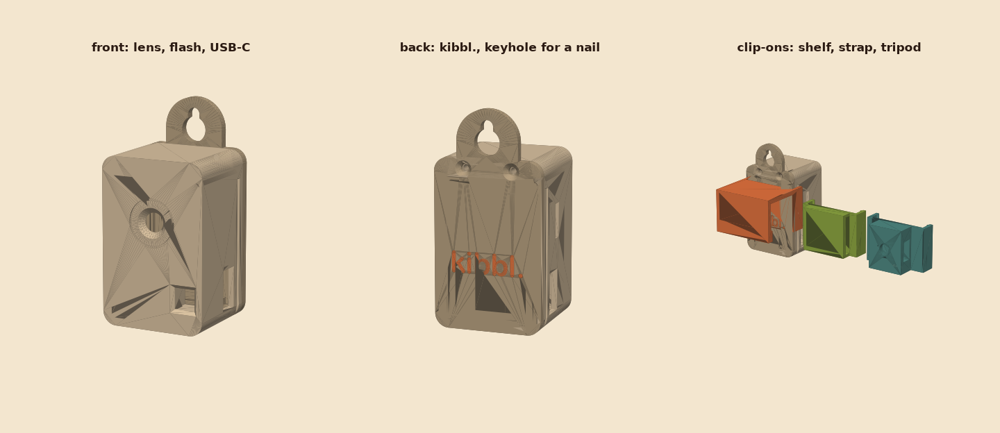

# kibbl. cam case

A small case for the kibbl. cam: the AI-Thinker ESP32-CAM on its USB-C programmer board (ESP32-CAM-MB, same 40 × 27 mm footprint), powered and set up through the USB-C port. 49 × 31 × 28 mm (63 mm long with the hanging tab), under 20 g of filament.



## What is where

| | |
| --- | --- |
| Front | lens opening with a 66° viewing cone and a ring groove; flash window with a light tunnel, so the flash does not shine back into the lens inside the case |
| USB-C end | slot open to the back, with a recess so the plug goes all the way in |
| Long sides | a window where the red status led glows (it sits between the two boards); tool slots to the IO0 and RST buttons of the MB, also the vents; the V-grooves the clip-ons grip |
| Top | solid block with the two cover screws |
| Back | **kibbl.** engraved; a keyhole tab to hang it on a nail or screw |

The positions of lens, flash led and status led come from the ESP32-CAM 3D model, checked against the case with `case.py --check` (no part of either board touches the case; lens and flash 0.01 mm off their openings).

## Printing on the Bambu Lab A1

| File | Material | Orientation (as exported) | Notes |
| --- | --- | --- | --- |
| `case_front.stl` | PETG or PLA | front face on the bed | the face people see gets the bed's finish (textured PEI looks best); no supports |
| `case_back.stl` | PETG or PLA | back face on the bed | the engraving prints in the first 3 layers |
| `case_label.stl` | any second colour | – | optional, see below |
| `clip_shelf.stl`, `clip_strap.stl`, `clip_tripod.stl` | PETG preferred (the arms flex) | standing, as exported | no supports; small bridges only |

0.2 mm layers, 3 walls, 15–20 % infill. Everything fits one plate.

**Two-colour label with the AMS lite**: in Bambu Studio add `case_back.stl`, then right-click it → *Add part* → `case_label.stl` (both files share the same coordinates, so the letters drop into the engraving). Give the label part the second filament. The colour only changes in the first 3 layers.

## Hardware

| | Qty | |
| --- | --- | --- |
| M2 × 8 self-tapping screws (countersunk) | 2 | cover into the top block |
| ¼"-20 hex nut | 1 | only for the tripod clip-on |
| velcro strap 20 mm or zip ties | – | only for the strap clip-on |

## Assembly

1. Plug the camera board onto the MB as it is now.
2. Lower the stack into the front shell, camera first: the lens sits in front of its opening, the USB-C port in its slot.
3. Press the back cover on (its lip and rails hold the MB) and fix it with the two M2 screws at the top.
4. Plug in USB-C. Set up the Wi-Fi in the app (Devices → *Set up over USB*), then move it where it should watch.

**Hanging**: drive a nail or screw so its head stands 4 mm off the wall, pass the head through the round part of the keyhole and let the camera drop: the slot holds the shank and the head keeps the case against the wall. The USB-C cable leaves downwards.

**Buttons**: a toothpick through the side slots near the USB-C end reaches IO0 and RST of the MB. Rarely needed: flashing and the app's USB setup reset the board themselves, and three quick power cycles (unplug, plug in, within 10 s each) make it forget its Wi-Fi.

## Clip-ons

All clip-ons start with the same cradle: it hugs the back and both long sides and snaps into the V-groove on each side (or slides on from the USB-C end). Its ridges sit 0.6 mm in the 0.8 mm grooves, with 0.2 mm of play.

| Clip-on | Use |
| --- | --- |
| shelf | hooks over a shelf or the top of a monitor, 20 mm thick (`SHELF`), the camera hangs in front of the edge |
| strap | a loop for a 20 mm velcro strap or zip ties: cage bars, chair or table legs, poles |
| tripod | a captive ¼"-20 nut (slides in from the side), the screw comes from behind: any mini tripod or ball head, and so any desk stand |

**Making a new clip-on**: start from `cradle(x0)` in `case.py` and add to it, as the three above do. The interface is the groove: a 90° V, 0.8 mm deep and 1.6 mm wide on the case surface, `GROOVE_Z` (22.6 mm) behind the front face, along both long walls from 8 mm below the top to the USB-C end.

## Before the first print: one measurement

Everything on the camera board comes from its model. The one number taken from the usual parts instead is the distance between the two boards (`HEADER_STACK`, 11.0 mm: an 8.5 mm female header plus the 2.5 mm spacer of the camera's pins). Measure from the back of the camera board to the front of the MB; if it differs, set `HEADER_STACK` and run `python case.py` again. A smaller gap only leaves the stack some play (a 1 mm foam pad behind the MB takes it up), a larger one keeps the cover from closing.

The USB-C slot spans 17.5 mm to the back rim, which covers a top-mounted and a mid-mounted port.

## Files

```bash
pip install -r ../../requirements.txt
python case.py                       # STEP + STL into step/ and stl/
python case.py --check ESP3-CAM_v4.step   # against the board model (thingiverse, CC-BY)
python render.py                     # images/case.png
```

`step/case_assembly.step` opens in Fusion with the shell and the cover in place.
