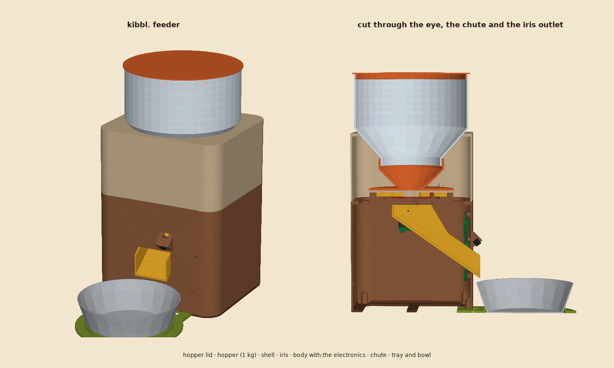
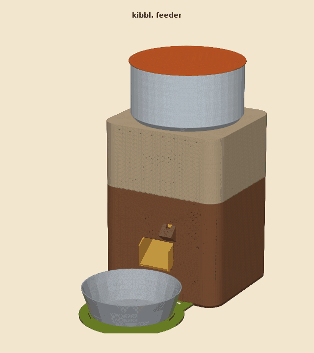
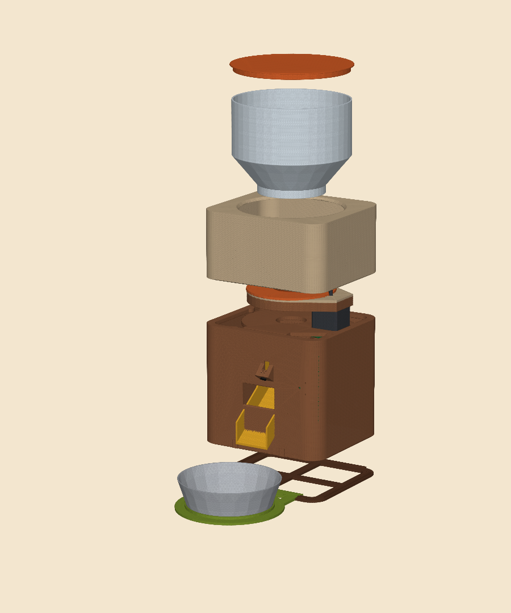
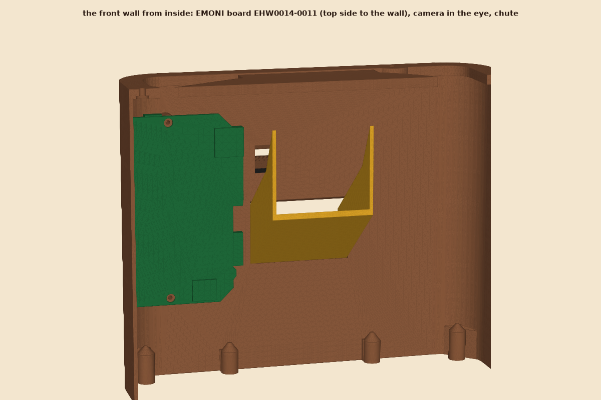
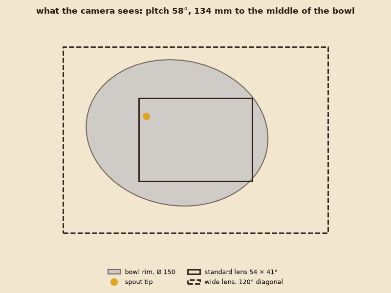

# Feeder assembly

The whole cat feeder around the [iris](../iris): a hopper for 1 kg of dry food on top, the iris in the middle, and below it a body that holds the chute to the bowl and the electronics: an EMONI main board **EHW0014-0011 (without buzzer)** with its camera watching the bowl, its red and green LEDs and the button showing through the front, and the BTT S42B on the back of the motor. The iris goes in as it is, no part of it changes.



| | |
| --- | --- |
| Size | 200 × 180 mm, the tray 162 mm in front of it; 378 mm high with the lid |
| Hopper | 2455 ml above the closed iris: **1031 g** of dry food at 0.42 g/ml, the low end of 0.40-0.55 |
| Chute | 50 mm wide, 35° from the iris outlet out through the front wall; the spout ends 20 mm in front of the body, 14 mm above the bowl rim and 16 mm inside it |
| Bowl | any bowl with a foot up to Ø 123 mm and a rim around Ø 150 mm (a usual stainless one); a ring on the tray keeps it in place |
| Electronics | EMONI board on the inside of the front wall, right of the chute; S42B under the iris on the motor; 12 V in at the back |
| Camera | in the eye above the spout, 58° down, 134 mm to the middle of the bowl; a 75 mm flex reaches J2 (route 72 mm) |



The motor is hidden in the body: the NEMA 17 hangs from the underside of the iris base, 67.5 mm right of the outlet, through the square cut-out in the deck, with the S42B on its back facing down. The second turn of the GIF opens the right side of the housing to show it.



## What is where

From the top:

* **hopper_lid**: plug lid, its rim stands 2.5 mm over the hopper to lift it.
* **hopper**: cylinder Ø 175 and a 50° cone (kibble rests at 30-35°, so it all runs out). The spigot at its bottom drops 10.5 mm into the iris funnel's collar with 0.6 mm play, the cone sits on a matching seat in the shell: the weight goes into the shell, not into the iris. Lift it off to clean it.
* **shell**: the sleeve around the iris and funnel. Ribs on its inside locate the iris base (three around the circle, two at the motor lobe), and three clamps hold it down: two on the funnel flange between the lid screws, one on the lid above the motor. Four M3 screws from below through the deck.
* **iris**: stands on the deck, motor and S42B hanging through the square cut-out, the outlet over the deck's Ø 46 hole.
* **body**: walls, the deck at the top, and inside:
  * two lugs under the deck that carry the chute's top end;
  * on the inside of the front wall: two standoffs for the EMONI board, two light tunnels from the wall to 1 mm above the red (D4) and green (D5) LED, a Ø 4 hole in front of the button (S2) to press it with a pen;
  * the **eye**: a wedge on the front wall above the spout, its window facing the bowl, the camera module in a square pocket behind it;
  * the chute opening in the front wall; at the back a Ø 8.2 hole for a 12 V panel jack and a 12 × 7 cable slot;
  * filled corners for the floor screws, two bosses at the foot of the front wall for the tray.
* **chute**: flat floor, side walls, and a box under the iris outlet that reaches up to the deck, so nothing bounces out. Printed lying on its floor: the kibble slides on the smooth bed side.
* **floor**: closes the body, a lip inside the walls. Everything inside is reached from below with the floor off.
* **tray**: in front of the body under the bowl; its tongue fills a notch in the floor under the front wall. It keeps the bowl where the camera and the spout expect it, and the cat standing on it keeps the feeder from tipping forward.



### The EMONI board

EHW0014-0011 stands on the inside of the front wall, its **top side towards the wall**, 8 mm off it (the tallest part, the button, is 4.4 mm). Its long side is upright: the USB-C (J3) at the top, the antenna edge towards the chute.

| | world (x right, z up) | |
| --- | --- | --- |
| Red LED D4, green LED D5 | x 79, z 123 and 106 | through the front wall, light tunnels |
| Button S2 | x 69, z 114 | Ø 4 hole |
| Camera connector J2 | x 45, z 114 | the flex leaves towards the antenna edge, to the eye at x 14 |
| USB-C J3 | top edge, z 165 | 16 mm to the deck: room for an angled USB-C plug, for power |
| Mounting holes | Ø 5, 94 mm apart, upright | M3 × 8 with washers into the standoffs |

The antenna (ESP32-S3-WROOM-1) sits at the board's edge next to the plastic chute, the motor is 57 mm behind the board.

`feeder.py --check` uses the board's own STEP (`(21) Hardware/enny-hardware-ehw0014/EHW0014-0011/EHW0014-0011 w_o Buzzer v3.step`) when it is next to this repository, and else an envelope of the board and its tall parts. The STEP files here only hold the envelope: the board's design stays in its own repository.

### The camera



A 24-pin OV2640 or OV5640 module with a **75 mm flex** (the 21 mm and 40 mm ones do not reach): pushed into the eye's pocket from inside, lens through the window, held with a drop of hot glue. The standard lens (66° diagonal) sees about 137 × 100 mm around the middle of the bowl, the rim is outside the picture. **A 120° lens sees the whole bowl, the spout and the cat's head**, and is the one to buy.

## Files

| File | |
| --- | --- |
| `feeder.py` | the design: every dimension is a parameter at the top, the layout follows from them |
| `stl/*.stl` | parts lying in their print orientation |
| `step/*.step` | parts in their assembled place; `assembly.step` with the iris, motor, S42B, screws of the iris, camera, bowl and the board envelope, each body named and coloured |
| `render.py` | the pictures here; `--orbit` only the turning GIF |

```bash
pip install -r ../../requirements.txt
python feeder.py --quick    # the numbers only
python feeder.py --check    # and the solids: every pair of parts, print sizes (2-3 minutes)
python feeder.py            # check, then STEP + STL
python render.py
```

`--check` refuses to export a design that does not hold 1 kg at 0.42 g/ml, whose spout is not above and inside the bowl, whose hopper spigot does not sit in the funnel collar, whose board touches the chute, the walls or (with its parts) the front wall, whose camera flex does not reach, where any two parts overlap (printed against printed and against the motor, S42B, board, camera and bowl), or with a part that does not fit the 256 mm bed of the Bambu Lab A1.

## Printing

| File | Material | Orientation (as exported) | Notes |
| --- | --- | --- | --- |
| `body.stl` | PETG or PLA | deck on the bed, upside down | no supports: the 59 mm bridge over the chute opening, the lugs and bosses grow up from the deck, the eye's top is 45°; 3 walls, 15 % infill |
| `shell.stl` | PETG or PLA | hopper seat on the bed | ribs and clamps have 45° undersides |
| `hopper.stl` | PETG | spigot on the bed | cone 40° from vertical; 3 walls; transparent PETG shows the fill level |
| `hopper_lid.stl` | PETG or PLA | top on the bed, lip up | |
| `chute.stl` | PETG | floor on the bed | the floor's bed side is the slide; smooth PEI is best |
| `floor.stl` | PETG or PLA | as is | |
| `tray.stl` | PETG or PLA | as is | |

The parts the food touches (hopper, chute, iris funnel) want PETG: PLA is fine for a prototype. Printed surfaces keep crumbs and fat: wash the hopper and chute, do not put food straight into a printed bowl.

## Hardware

| | Qty | |
| --- | --- | --- |
| EMONI main board EHW0014-0011, without buzzer | 1 | |
| OV2640/OV5640 camera, 24-pin, 75 mm flex, 120° lens | 1 | |
| 12 V supply ≥ 1 A, panel jack 5.5/2.1 with M8 thread (DC-022B) | 1 | |
| 12 V → 5 V buck module (e.g. MP1584 or Mini560, about 22 × 17 mm) and a short angled USB-C lead | 1 | on the floor with double-sided tape; 5 V into J3 |
| M3 × 8 socket head, M3 washer | 2 | board onto the standoffs |
| M3 × 10 | 2 | chute box into the lugs, from inside the box |
| M3 × 16 socket head | 4 | shell, from below through the deck |
| M3 × 16 countersunk | 4 | floor into the corners |
| M3 × 8 countersunk | 2 | tray tongue into the front wall, from below |
| Light pipe Ø 3 or a stub of clear filament | 2 | optional, in the LED holes |
| stainless cat bowl, rim about Ø 150, foot up to Ø 123 | 1 | |

Plus what the [iris](../iris/README.md#parts) needs.

## Assembly

1. Set up the S42B before it disappears in the body (Motor mA 600, calibration; see the iris README) and build the iris with its motor.
2. Camera: plug its flex into J2 of the board first. Push the module into the eye's pocket from inside, lens out through the window, a drop of hot glue.
3. Board onto the standoffs, top side to the wall, USB-C up: 2 × M3 × 8 with washers from the back of the board. Light pipes or clear filament into the LED holes if you like.
4. Chute: spout first, from inside out through the front opening, the box up between the lugs. Through the deck's outlet hole, 2 × M3 × 10 from inside the box out into the lugs.
5. Iris: turn the motor on the iris base so the S42B's signal header faces the front, then lower the iris onto the deck, motor and S42B through the square cut-out, outlet over the hole.
6. Shell over the iris (the ribs find the base), 4 × M3 × 16 from below through the deck.
7. Wiring: 12 V jack into the back wall; 12 V to the S42B and to the buck module, 5 V from it into J3. STEP, DIR and EN from the board to the S42B's header: which pins, the firmware decides.
8. Floor on, 4 × M3 × 16 countersunk. Tray tongue into the floor's notch, 2 × M3 × 8 countersunk from below.
9. Hopper into the shell (its spigot finds the funnel collar), food in, lid on.

## What is not checked yet

* **Tipping**: the full hopper puts 1 kg about 300 mm up on a 200 × 180 mm foot. The tray helps forwards, a cat pushing the hopper sideways does not meet much. Put ballast on the floor if it wobbles (the bay has room), or stand it against a wall.
* **The flex**: 72 mm of route on a 75 mm flex. If the module's flex is shorter, a 24-pin FPC extension fits, or move `EYE_X` and `EYE_ABOVE_MOUTH`.
* **Kibble on the chute**: 35° is a guess for crumbs and fat; if food stops on it, raise `CHUTE_ANGLE` (the body grows taller).
* **The USB-C plug**: 16 mm from J3 to the deck takes an angled plug. A straight lead needs `USB_ROOM` at about 30, which moves the board, and with it J2, further from the eye.

## Parameters worth changing

| Parameter | Default | Effect |
| --- | --- | --- |
| `HOPPER_CYL`, `HOPPER_R` | 80, 85 | food capacity; `--check` reports the grams |
| `KIBBLE_DENSITY` | 0.42 | g/ml of your food: weigh a litre |
| `BOWL_D`, `BOWL_H`, `BOWL_BASE_D` | 150, 45, 120 | your bowl; the spout height and the camera aim follow |
| `CHUTE_ANGLE` | 35 | slope of the chute; the deck and everything above it move |
| `SPOUT_ABOVE_RIM`, `NOSE` | 14, 20 | where the food leaves the spout |
| `EYE_X`, `EYE_ABOVE_MOUTH`, `CAM_FLEX` | 14, 14, 75 | camera position and the flex it must reach with |
| `CAM_HFOV`, `CAM_VFOV` | 54, 41 | the lens, for the view check |
| `BOARD_GAP`, `BOARD_X0`, `USB_ROOM` | 8, 33.5, 16 | where the board stands |
| `BED` | 256³ | your printer |
