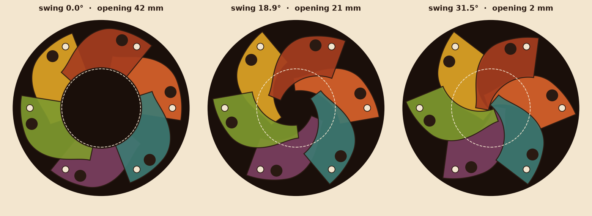
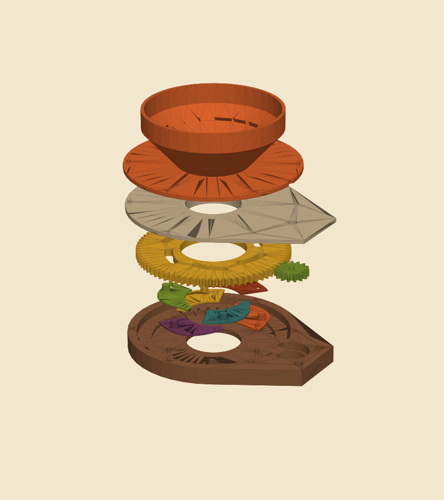
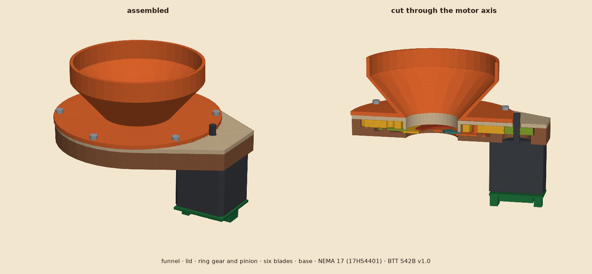
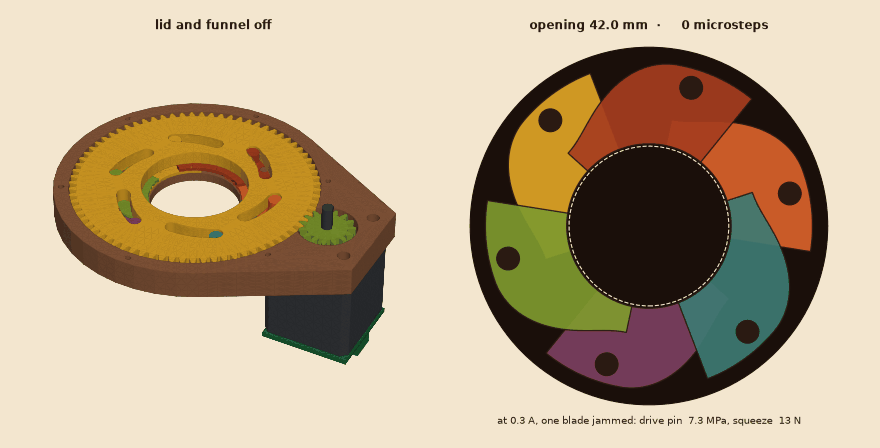
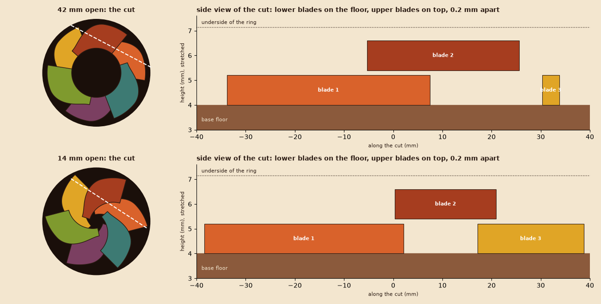
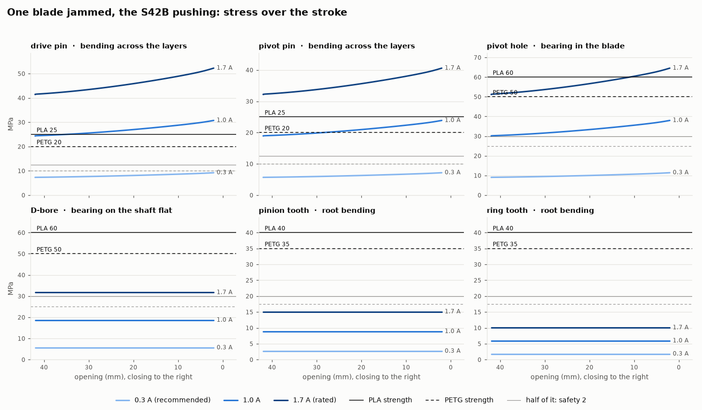

# Feeder iris (NEMA 17)

The portioning valve of the cat feeder: kibble rests on six blades under the hopper, a NEMA 17 turns the ring gear and the blades swing open like a camera aperture. How far and how long the iris opens decides how much falls into the bowl.



| | |
| --- | --- |
| Opening | 42 mm open, 2 mm closed (kibble is 8-12 mm) |
| Drive | NEMA 17 → 15 T pinion → 75 T ring gear (5:1, module 1.5) |
| Stroke | ring 31.5°, motor 157.5°, **1400 microsteps** at 1/16 from open to closed |
| Size | Ø 130 mm, 16 mm high without the funnel; the motor hangs 40 mm below, beside the outlet |
| Blades | 6 × 1.2 mm on two flat levels in a 3 mm cavity: 1, 3, 5 on the floor, 2, 4, 6 above them; no blade bends |







## Files

| File | |
| --- | --- |
| `iris.py` | the design: every dimension is a parameter at the top |
| `stl/*.stl` | parts lying in their print orientation, ready for the slicer |
| `step/*.step` | parts in their assembled place, and `assembly.step`, for Fusion, Onshape, FreeCAD |
| `step/assembly.step` | everything in place, each body named and coloured: the printed parts, the NEMA 17 (17HS4401), the BTT S42B v1.0 on its back and every screw; motor and driver are envelopes, not their detail |
| `render.py` | the pictures here, the stress profile and `images/iris-motion.gif` |

```bash
pip install -r ../../requirements.txt
python iris.py --check      # kinematics only
python iris.py              # check, then STEP + STL
python render.py
```

`--check` refuses to export a design that does not work: it verifies on the blade outline itself that the open blades stay out of the aperture, that the closed stop leaves at most 3 mm, that never more than two blades overlap (the cavity height), that no blade ever overlaps one on its own level and every upper blade rests on both neighbours, that the blades stay inside the housing, that no blade ever covers another blade's pins or boss, that the ring slots push the pins at a pressure angle below 55°, and that with one blade jammed at the driver current the weakest part keeps a safety of 2 (see Loads). Interference of the solids, blades against blades included, was checked with every part pair at eleven positions over the stroke: none.

Why two levels: a blade only ever overlaps its two neighbours. Woven like a camera iris, each blade would lie under one neighbour and over the other, and had to step 1.2 mm between the two within 12 mm when open and 0.2 mm when closed: printed blades cannot bend that, they jam. With six blades (even) every second one sits one level up, flat, on a boss of the base around its pivot and on the lower blades beside it, which it overlaps by at least 48 mm² on each side over the whole stroke. From above the blades overlap, as any iris must to close; from the side they lie on two levels:



### Editing in Fusion

Open `step/assembly.step` (File → Open, or upload to a Fusion project): every part comes in as a body in its place. Add a revolute joint on the ring to see the stroke. Changes made there do not flow back into `iris.py`; when the design moves to Fusion for good, export the `.f3d` and the STEP files into `fusion/` here and treat those as the source.

## Parts

| Part | Qty | Material | Notes |
| --- | --- | --- | --- |
| `base.stl` | 1 | PETG | floor on the bed, 3 walls, 30 % infill |
| `blade.stl` | 3 | PETG or PLA | lower blades 1, 3, 5; 0.2 mm layers (6 layers), 100 % infill, smooth bed side down |
| `blade_upper.stl` | 3 | PETG or PLA | upper blades 2, 4, 6, pin 1.3 mm shorter; same settings |
| `ring.stl` | 1 | PETG | 4 walls, 40 % infill; the teeth carry the load |
| `pinion.stl` | 1 | PETG | 100 % infill |
| `lid.stl` | 1 | PETG/PLA | plate on the bed, sleeve up |
| `funnel.stl` | 1 | PLA | flange on the bed |

Every part can be PLA at 0.3 A (see Loads). PETG takes more heat, and is the usual choice for the parts the kibble touches (funnel, lid sleeve, blades, base bore).

| Hardware | Qty | |
| --- | --- | --- |
| NEMA 17 stepper, 5 mm D-shaft ≥ 20 mm (e.g. 17HS4401) | 1 | |
| Closed-loop driver, BTT S42B v1.0 | 1 | on the back of the motor; current set to 0.3 A (see Loads) |
| M3 × 8 socket head | 4 | motor, from the top through the counterbores |
| M3 × 16 | 6 | funnel + lid into the base (self-tapping into 2.8 mm holes) |
| M3 × 6 grub screw | 1 | pinion onto the shaft flat |
| 12 V supply, ≥ 1 A | 1 | |

## Assembly

1. Screw the motor to the underside of the base: shaft up through the 22 mm hole, 4 × M3 × 8 from the top.
2. Put the three `blade` parts on the plain pivot pins and the three `blade_upper` parts on the pins with a boss, drive pins up, all folded outwards (open). The upper blades lie flat on their boss and on the lower blades.
3. Turn the ring clockwise as far as the slots allow (open) and lower it onto the ledge so every drive pin drops into its slot.
4. Push the pinion onto the shaft, flat towards the grub screw, mesh it with the ring, tighten the grub screw on the flat.
5. Lid on top (sleeve down into the ring), funnel on the lid, 6 × M3 × 16 through both into the base.
6. Turn the motor by hand: the iris must close and open without a catch. The chute to the bowl is part of the feeder stand, it fits under the 42 mm outlet. A blade that drags: sand its edge, or raise `LEVEL_GAP` by one layer (0.2 mm).

## Motion

Seen from above the ring turns counter-clockwise to close, so the motor turns clockwise. The slot ends are the hard stops at fully open and fully closed.

| Motor microsteps from open (1/16) | Ring / blade swing | Opening |
| ---: | ---: | ---: |
| 0 | 0° | 42 mm |
| 267 | 6° | 37 mm |
| 533 | 12° | 30 mm |
| 800 | 18° | 22 mm |
| 1067 | 24° | 14 mm |
| 1200 | 27° | 9 mm |
| 1333 | 30° | 4 mm |
| 1400 | 31.5° | 2 mm (closed stop) |

* **Homing**: the S42B closes the loop on its encoder and keeps pushing against a hard stop instead of stalling. Home at the set 0.3 A: step towards open past the stop by a few degrees, then take that as 0; a switch at the open position is the cleaner way.
* **Portions**: open to a set opening (e.g. 22 mm, 800 microsteps) for a set time, then close. Grams per second depend on the kibble; weigh a few runs once and the feeder doses by time. Closing through falling kibble: if the closed position is not reached in time, reopen a little and close again, rather than raising the current.
* The feeder joins the server as a device with the `feeder` capability (`docs/protocol.md`, command `{"cmd":"feed","portions":n}`).

## Loads



The worst case is a kibble wedged under one blade while the motor pushes. The ring then stops on that blade's drive pin alone, and the linkage multiplies the force: the pin sits 8.6 mm from its pivot, so the ring pushes it mostly outwards, with the whole ring torque on that short arm. At the rated 1.7 A that is 250-310 N on one Ø 6 pin. Printed upright, the drive and pivot pins bend across their layers, the weakest direction of a print. `loads()` in `iris.py` has the formulas (Lewis for the teeth, the pins as cantilevers); the strengths are conservative values for printed parts at 100 % infill, check the data sheet of your filament.

Weakest part over the stroke, one blade jammed, safety against PLA (PETG):

| S42B current | Motor torque | Squeeze on a kibble | Drive pin | Pivot pin | Pivot hole | Teeth, D-bore |
| ---: | ---: | ---: | ---: | ---: | ---: | ---: |
| **0.3 A** | 0.07 N·m | 13 N | 9 MPa, **2.7** (2.2) | 7 MPa, 3.5 (2.8) | 11 MPa, 5.3 (4.4) | ≥ 10 |
| 0.4 A | 0.10 N·m | 18 N | 12 MPa, 2.0 (1.6) | 10 MPa, 2.6 (2.1) | 15 MPa, 3.9 (3.3) | ≥ 8 |
| 1.0 A | 0.25 N·m | 45 N | 31 MPa, 0.8 (0.7) | 24 MPa, 1.0 (0.8) | 38 MPa, 1.6 (1.3) | ≥ 3 |
| 1.7 A (rated) | 0.42 N·m | 76 N | 52 MPa, 0.5 (0.4) | 41 MPa, 0.6 (0.5) | 65 MPa, 0.9 (0.8) | ≥ 1.6 |

* **Set the S42B to 0.3 A.** At 1.0 A and above a jammed kibble breaks a pin, in PLA and in PETG. `--check` holds the design to a safety of 2 at `DRIVER_A` in `MATERIAL` (0.3 A, PLA).
* Without a jam the six pins share: at 0.3 A each sees 1.5 MPa. Moving the blades and kibble aside takes far less than the 13 N the blades squeeze with; check once that 0.3 A opens and closes reliably with a full hopper.
* The S42B holds its force for as long as the position is not reached. A jam that is left pushing loads the pins for hours, and PLA creeps under a steady load: the firmware has to give up, reopen and retry after a short time, and stop after a few tries.
* PLA softens from about 55 °C: keep the feeder out of direct sun and away from a radiator. PETG holds to about 70 °C.
* The ring floats 0.4 mm in its pocket, so the mesh cannot push it far enough off the pinion to skip (contact ratio 1.39 at the limit, 1.65 nominal). The kibble resting on the closed iris is about 1.4 N: the blades sag less than 0.1 mm.

## Parameters worth changing

| Parameter | Default | Effect |
| --- | --- | --- |
| `R_AP` | 21 | aperture radius; blades, pins and housing follow, run `--check` |
| `BLADE_T`, `CAVITY` | 1.2, 3.0 | blade thickness and the room for two of them |
| `PIVOT_HOLE_D`, `SLOT_W` | 4.0, 6.5 | fit of the pins; open by 0.1-0.2 if your printer runs tight |
| `DRIVE_PIN_D` | 6.0 | strength of the drive pins, see Loads; the slot follows with `SLOT_W` |
| `ALPHA_MAX` | 31.5 | the closed stop; 33 closes completely but stacks three blades at the centre |
| `TEETH_RING`, `TEETH_PINION` | 75, 15 | gear ratio, the motor moves with `CENTER_DIST` |
| `SHAFT_D`, `SHAFT_FLAT` | 5.15, 4.65 | motor shaft fit |
